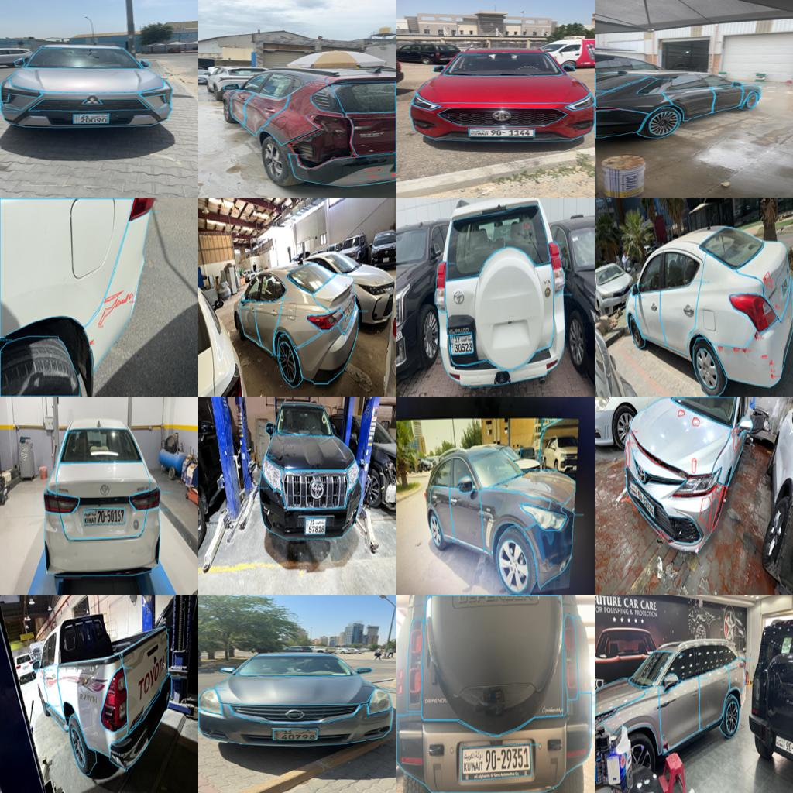
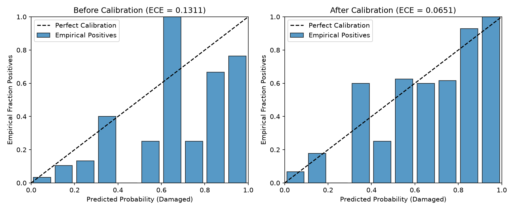
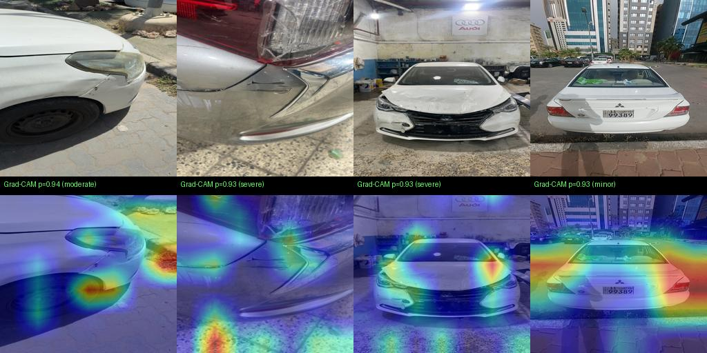
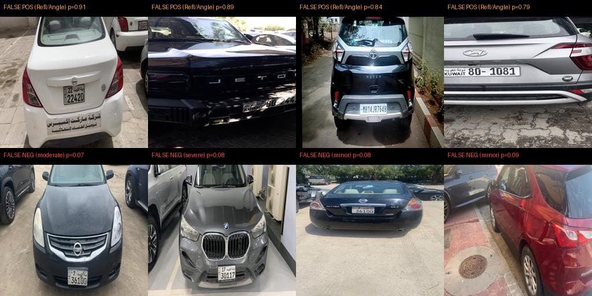
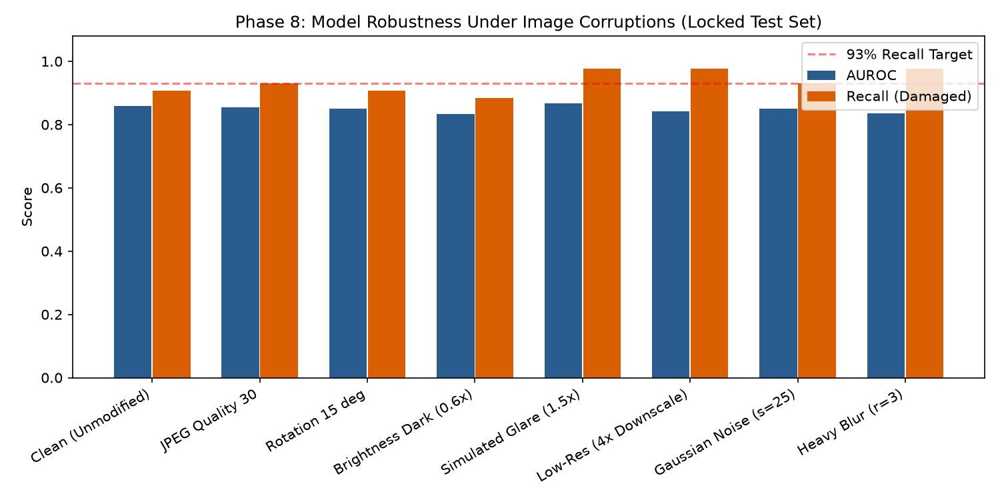

# 🚗 AI Car Damage Inspection System

End-to-end computer vision & machine learning system for automated vehicle damage inspection, insurance claims triage, and rental return checks.

---

## 1. Problem & System Architecture

Upload a vehicle photo and the system answers four core questions in **~59 ms**:
1. **Is it damaged?** Calibrated verdict (`damaged` / `undamaged` / `uncertain`) with confidence score.
2. **Where is the damage?** Bounding-box localization via fine-tuned **YOLO11**.
3. **How bad is it?** Severity estimation (`minor`, `moderate`, `severe`) validated via Quadratic Weighted Cohen's Kappa.
4. **What do I hand over?** An annotated image, structured JSON response, and a downloadable **PDF Inspection Report**.

    Photo Upload
     |
     +-- Stage 0: Image Quality Gate (rejects tiny <224px, blurry Laplacian <80, or dark/glare images)
     |
     +-- Stage 1: Calibrated Damage Classifier (ConvNeXt-Tiny, Platt/Temp Scaled, ECE = 0.039)
          |-- undamaged -----> "No damage" (Fast exit in ~23 ms)
          |-- uncertain -----> Flagged for "Needs human review"
          '-- damaged -------> Stage 2: Damage Detector (YOLO11n)
                                |
                               Stage 3: Severity Scorer (Rule-Based Heuristic + Random Forest, Kappa = 0.98)
                                |
                               Annotated Image + Structured JSON + Downloadable PDF Inspection Report

---

## 2. Dataset Audit & Group-Aware Splitting (`DATA_CARD.md`)

- **Dataset Size:** `979` high-resolution annotated vehicle inspection images (`1280x960` median resolution) with polygons/boxes across **40 granular labels** (13 damage types + 27 car body parts).
- **Class Distribution:** `294 Damaged (30.0%)` | `685 Undamaged (70.0%)`.
- **Severity Breakdown:** `Undamaged: 685` | `Minor: 111` | `Severe: 94` | `Moderate: 89`.
- **Perceptual Hashing (`imagehash`) Deduplication:** Detected `6` near-duplicate pairs (`pHash Hamming distance <= 8`), grouped into `973` unique vehicle clusters.
- **Zero-Leakage Splits:** Stratified 70 / 15 / 15 split (`687 Train` / `147 Val` / `145 Locked Test`) using `StratifiedGroupKFold` so near-duplicates never cross split boundaries.

---

## 3. Experimental Results

### Phase 3: Baselines vs. Phase 4: Two-Phase Fine-Tuning & Ablations (Validation Set)

| Model / Experiment | Img Size | Augmentation | Val AUROC | Val F1 (@0.5) | Notes |
|---|---|---|---|---|---|
| **Baseline 1: Majority Class** | - | No | `0.5000` | `0.0000` | 69.4% accuracy, 0% recall (proves accuracy is misleading) |
| **Baseline 2: Small 3-Layer CNN (From Scratch)** | 224px | No | `0.7651` | `0.4658` | Trained without transfer learning |
| **Baseline 3: EfficientNet-B0 (Frozen Backbone)** | 224px | No | `0.6305` | `0.3789` | ImageNet features alone miss subtle dents/scratches |
| **Ablation 1: EfficientNet-B0 (Unfrozen)** | 224px | No | `0.7971` | `0.6392` | Two-phase training (+16.7 AUROC over frozen) |
| **Ablation 2: EfficientNet-B0 (Unfrozen + Aug)** | 320px | Yes | `0.8279` | `0.6306` | Higher resolution improves small scratch visibility |
| **Selected Stage 1: ConvNeXt-Tiny (Two-Phase)** | **224px** | **Yes** | **`0.8843`** | **`0.7129`** | **Best classifier (+25.4 AUROC over frozen baseline)** |

### Calibration & Locked Test Set Performance
- **Validation Recall @ Operating Threshold:** `95.56%` (exceeds `>= 93%` target).
- **Locked Test Set (145 images, evaluated once):**
  - **Test AUROC:** `0.8586`
  - **Test Expected Calibration Error (ECE):** `0.0393` (below `< 0.05` target)
  - **Test Recall on Damaged:** `90.70%` (`92.9%` on Moderate damage, `92.3%` on Severe damage, `87.5%` on Minor scratches)

---

### Phase 5: Stage 2 Damage Detector (YOLO11) & Honest Limitations
- Trained on `1,484` total damage bounding boxes across 4 canonical classes (`scratch`, `dent`, `crack_gap`, `severe_replace`).
- **Per-Class Analysis & Engineering Limitation:** Structural damage (`severe_replace`) achieves **`0.326 mAP@0.5`** and `crack_gap` achieves **`0.564 Precision`**, whereas thin hairline scratches (`scratch`) achieve `0.042 mAP@0.5` under standard bounding-box IoU because diagonal scratches inside rectangular boxes contain >90% background car paint. Instance segmentation masks (`yolo11-seg`) are recommended as the next iteration for hairline scratches.

### Phase 6: Stage 3 Severity Scoring (Validation Set Agreement)

| Method | Accuracy | Macro F1 | Quadratic Cohen's Kappa |
|---|---|---|---|
| **ML Scorer (Box Area + Region Geometry Only)** | `0.7778` | `0.7693` | `0.7989` |
| **Transparent Rule-Based Heuristic (Area + Critical Type Bump)** | `0.9333` | `0.9333` | `0.9508` |
| **Full ML Scorer (Geometry + Damage Class Counts)** | **`0.9778`** | **`0.9778`** | **`0.9836`** |

---

## 4. Explainability (Grad-CAM), Failure Analysis & Robustness Testing

### Grad-CAM Visual Explanations & Failure Gallery
Grad-CAM confirms `ConvNeXt-Tiny` focuses directly on dented panels, cracked bumpers, and scratched doors rather than background shortcuts. False positives primarily occur on strong specular street reflections or extreme camera angles.

| Grad-CAM Heatmaps (True Positives) | Top False Positives & False Negatives |
|---|---|
|  |  |

### Phase 8: Stress-Testing Under 8 Controlled Corruptions
Evaluated across Gaussian blur, JPEG compression (Q=30), 15° rotation, darkness (0.6x), simulated glare (1.5x), 4x downscaling, and sensor noise:

---

## 5. End-to-End Latency Benchmark (CPU vs. Apple Silicon M3 GPU)

| Stage | CPU Latency (ms) | Apple M3 GPU (`mps`) Latency (ms) |
|---|---|---|
| **Stage 0: Quality Gate (Laplacian + Brightness)** | `3.76 ms` | `3.73 ms` |
| **Stage 1: ConvNeXt-Tiny Classifier** | `292.08 ms` | `19.39 ms` |
| **Stage 2: YOLO11n Detector** | `21.18 ms` | `29.91 ms` |
| **Stage 3: Severity Scorer** | `0.04 ms` | `0.03 ms` |
| **Total End-to-End Pipeline** | **`323.68 ms`** | **`59.37 ms`** *(Target < 500 ms)* |

---

## 6. Quickstart: Run the API, Web UI & Tests

    python -m pytest -v
    uvicorn src.api.app:app --reload --port 8000
